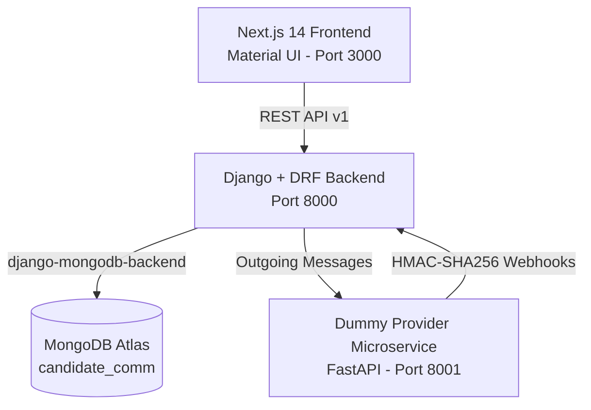

# Candidate Communication Platform

A production-grade Candidate Communication Platform built for Hunar.ai.

## Architecture Overview



## Tech Stack
- **Frontend**: Next.js 14 (App Router), React 18, TypeScript (strict), Material UI (MUI v5).
  - Mobile-first responsive layout (360px up to 4K). Touch targets >= 44px. Custom tokens.
- **Backend**: Python 3.13 / Django 6.1 + Django REST Framework + `django-mongodb-backend`.
  - Clean architecture: `views -> services -> provider adapters -> models`.
  - Database: MongoDB Atlas (`candidate_comm`).
- **Dummy Provider**: Standalone microservice (`/provider-service`) on port 8001 using FastAPI + uvicorn.
  - Simulates message delivery, deterministic error responses, webhook callbacks with HMAC signatures.

## Repository Layout
```
/frontend             # Next.js App Router application (port 3000)
/backend              # Django REST API backend (port 8000)
/provider-service     # Standalone dummy provider microservice (port 8001)
/design               # 26 UI mockups and developer notes
/docs                 # Assignment, email brief, progress, review
README.md             # Project documentation and setup guide
DECISIONS.md          # Architecture decisions and design assumptions
```

## Prerequisites
- Node.js v20+ and npm
- Python 3.13+
- MongoDB Atlas cluster access (connection string configured in `backend/.env`)

## Service Setup & Execution

Create one Python 3.13 environment from the repository root, then install each service's dependencies:

```powershell
py -3.13 -m venv .venv313
.\.venv313\Scripts\python.exe -m pip install -r backend\requirements.txt
.\.venv313\Scripts\python.exe -m pip install -r provider-service\requirements.txt
```

Keep the existing `backend/.env` intact; add missing configuration values to it manually. Copy a service `.env.example` only when that service does not already have a local `.env`.

### 1. Dummy Provider Service (Port 8001)
```bash
cd provider-service
..\.venv313\Scripts\python -m uvicorn main:app --host 127.0.0.1 --port 8001
```
Health check endpoint: `GET http://127.0.0.1:8001/health`

### 2. Backend Service (Port 8000)
```bash
cd backend
# Database connection ping & health check run on startup
..\.venv313\Scripts\python manage.py migrate
..\.venv313\Scripts\python manage.py runserver 127.0.0.1:8000
```
Health check endpoints:
- `GET http://127.0.0.1:8000/api/v1/health` (Backend & MongoDB Atlas connection status)
- `GET http://127.0.0.1:8000/api/v1/health/provider` (Provider health check proxy)

### 3. Frontend Service (Port 3000)
```bash
cd frontend
npm install
npm run dev
```
Accessible at: `http://localhost:3000`

## Deterministic Test Numbers
The dummy provider behaves deterministically based on phone number suffix:
- **Ends in `0000`**: Fails immediately with `422 invalid_recipient`. (Permanent error, no retry)
- **Ends in `0429`**: Fails immediately with `429 rate_limited` with `Retry-After: 5`. (Retryable error)
- **Ends in `0503`**: Fails with `503 temporary_failure` on attempts 1 and 2; succeeds on attempt 3. (Demonstrates auto-retry)
- **Ends in `0500`**: Accepted immediately (`202 Accepted`), later emits webhook `failed` with `delivery_failed`.
- **All other numbers**: Accepted (`202 Accepted`), emits webhook progression: `sent` (~1s), `delivered` (~3s), `read` (~6s).

## Environment Configuration

Copy each service's `.env.example` to `.env` only when that service does not already have a local `.env`. Keep secrets out of source control. Configure the same random `PROVIDER_WEBHOOK_SECRET` in `backend/.env` and `provider-service/.env`.

| Service | Variables |
|---|---|
| Backend | `MONGODB_URI`, `DJANGO_SECRET_KEY`, `DEBUG`, `FRONTEND_ORIGINS`, `PROVIDER_BASE_URL`, `BACKEND_URL`, `PROVIDER_WEBHOOK_SECRET` |
| Provider | `PROVIDER_WEBHOOK_SECRET`, `BACKEND_WEBHOOK_URL` |
| Frontend | `NEXT_PUBLIC_API_URL` |

For Atlas, create a database user with read/write access to `candidate_comm`, allowlist the development/deployment egress IP, and place the Atlas connection string in the backend environment. The application pings Atlas at server startup; migrations create the collections and indexes. Use placeholders in documentation and never paste credentials into this file.

## API and Verification

Versioned endpoints include `GET/POST /api/v1/candidates`, `GET/DELETE /api/v1/candidates/{candidate_id}`, `GET /api/v1/candidates/{candidate_id}/messages`, `POST /api/v1/messages`, `POST /api/v1/messages/bulk`, `POST /api/v1/messages/{recipient_id}/retry`, `POST /api/v1/webhooks/provider/`, and `GET /api/v1/health/provider`.

Run checks from the repository root:

```powershell
.\.venv313\Scripts\python.exe -m pytest backend
.\.venv313\Scripts\python.exe -m pytest provider-service\test_main.py
.\.venv313\Scripts\python.exe backend\manage.py check
cd frontend; npm run build
cd frontend; npm run lint
```

`backend/scripts/check_db_ping.py` performs a standalone Atlas ping without displaying the connection string. The seeded test candidates in `backend/seed_data.py` cover the suffix scenarios above; **the seed script clears existing candidate and message data before reseeding, so use it only against a disposable demo database**.

## Deployment Notes and Limitations

- Deploy frontend, Django API, provider service, and Atlas as separate services. Set `FRONTEND_ORIGINS` to the exact deployed frontend origin, configure the backend/provider URLs, and use TLS for public traffic.
- Set `DEBUG=False`, a unique Django secret, and a shared random webhook secret in the deployment environment. Restrict Atlas network access to the backend's egress IP.
- The dummy provider stores message and idempotency state in memory; restarting it clears its status lookup and retry counters. Webhook simulations are best-effort background tasks, not a durable queue.
- Atlas connectivity and full external-service E2E checks depend on network access. Responsive screenshot comparisons at 360/768/1280 remain open.
- Implemented bonus coverage currently includes auto/manual retry and provider health reporting. Templates, scheduled messages, and multiple provider channels are not complete.
- The frontend has no dedicated Vitest/RTL setup yet; backend and provider unit checks are available through pytest.

## Assumptions

- The demo uses MongoDB Atlas database `candidate_comm`; local credentials and service configuration belong in ignored `.env` files.
- No mobile design frames or `design/TOKENS.md` were supplied, so responsive behavior follows the desktop design language and is still awaiting screenshot review.
- Provider health down-state disables sends rather than queuing them.

## Done and Not Done

- Core P1–P5: candidate management, single and bulk messaging, signed webhook status updates, history, failure handling, retry, and provider health are implemented. Backend/provider checks and core API scenarios were previously exercised; see [`docs/PROGRESS.md`](docs/PROGRESS.md) and [`docs/REVIEW.md`](docs/REVIEW.md).
- Bonus done: retry (automatic and manual) and provider health reporting.
- Bonus not done: templates, scheduled messages, and multiple provider channels.
- Still open: browser screenshot review at 360/768/1280 and frontend Vitest/RTL coverage. This cleanup pass reruns the requested backend/provider/frontend checks.

## How this was built

This project was built with the help of AI coding assistants for implementation. I defined the architecture and requirements, directed the work through a phased plan, and reviewed and tested the result.
Decisions and trade-offs are documented in DECISIONS.md.
